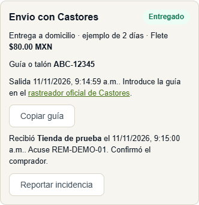

# Envíos con Grupo Castores

El piloto cubre envíos nacionales de mercancía seca de un solo proveedor por pedido. Una solicitud admite varios productos y cantidades de ese proveedor. Para orígenes distintos se cotiza cada salida. El flujo de entrega acordada sigue disponible, por ejemplo para reparto local o productos que requieren frío.

## Elección del transportista

Para el costal de semillas y futuras compras de mayor volumen elegimos Castores por sus servicios de paquetería y carga consolidada, el cotizador público y el rastreo mediante guía o talón. Paquetexpress también ofrece paquetería con rastreo. ATRT se especializa en transporte refrigerado para frescos. La tarifa más conveniente depende del origen, el destino, el embalaje y el volumen. Cada cotización requiere confirmar la aceptación del producto y la cobertura concreta. [Grupo Castores](https://www.castores.com.mx/servicios/paqueteria.html) · [Paquetexpress](https://www.paquetexpress.com.mx/preguntas-frecuentes/) · [ATRT](https://atrt.com.mx/)

## Cómo presentarlo con tres cuentas

1. **Comprador.** En el catálogo agrega un costal de semilla de calabaza de 5 kg. Abre el carrito, selecciona la dirección, elige **Castores · flete cotizado y pago previo** en **Forma de entrega** y pulsa **Solicitar cotización**. Podrás volver al mismo carrito. En esta etapa la mercancía continúa disponible.
2. **Vendedor.** Abre **Pedidos → Cotizaciones de flete · Castores**. La solicitud indica los productos, las cantidades, la presentación y el CP de destino. Pesa y mide la carga embalada, consulta el servicio con Castores y captura el importe final, la referencia, el CP de origen, el plazo y la vigencia. Registra los demás costos previstos de la plataforma, incluidos empaque, gestión y cobro cuando correspondan. Si el servicio acepta la carga y hay margen positivo, pulsa **Publicar cotización**. Si falta cobertura, puedes comunicar el motivo al comprador. [Cotizador de Castores](https://www.castores.com.mx/)
3. **Comprador.** Pulsa **Actualizar cotización** o espera la consulta periódica mientras esté pendiente. Verás el flete en MXN y el total antes de confirmar. La cotización corresponde exactamente al comprador, la dirección, la mercancía y el método de pago elegido. Para la demostración usa **Transferencia bancaria** desde la solicitud inicial. El pago previo comprende mercancía y flete. Reutilizar el mismo intento conserva el folio y su reserva de inventario.
4. **Administración y vendedor.** Administración verifica el abono de la transferencia y registra su comprobante en **Pedidos**. Para pagos en línea habilitados, se utiliza la confirmación de la pasarela. El vendedor contrata la guía con Castores o en su cuenta de Envia.com y acuerda la recolección o lleva el paquete a la sucursal. Cuando el transportista lo recibe, abre el folio, pulsa **Registrar despacho** e introduce la guía y el costo real del flete. Se guardan la fecha de salida y el estado **Enviado**. La compra de la guía y la contratación de la recolección se hacen en el canal del operador. [Servicio de paquetería y recolección](https://www.castores.com.mx/servicios/paqueteria.html)
5. **Comprador.** En **Mis pedidos → Seguimiento con Castores** puedes copiar la guía, abrir el rastreador oficial y reportar una incidencia de entrega. Al recibir la mercancía, pulsa **Confirmar recepción**, escribe quién recibió y la referencia del acuse o remisión. También puede registrar el acuse administración. El vendedor ve la confirmación, la fecha y el mismo folio. Una guía emitida directamente por Castores se consulta con el talón de 11 dígitos o la guía con tres letras, guion y cinco o siete dígitos. [Manual oficial de rastreo](https://www.castores.com.mx/assets/files/manual-de-rastreo.pdf)

## Cómo se protege y mide el margen

El precio de flete publicado al cliente es el importe final cotizado por el operador. Se añade una sola vez al total y al monto del pago. La comisión de plataforma y el cálculo existente del IVA de la mercancía se calculan sobre los productos. El tratamiento contable y fiscal del transporte deberá validarse antes de facturar operaciones reales.

- **Antes del pedido**, margen previsto = comisión de la mercancía − otros costos previstos. El flete se recuperaría al precio cotizado. Se exige estimar los otros costos, incluso cuando el importe confirmado sea cero. Una previsión de margen cero o negativo impide publicar la tarifa.
- **Después del despacho**, margen observado = comisión efectivamente cobrada + flete efectivamente cobrado − flete real − otros costos reales. Administración registra los otros costos en **Medición del piloto** y puede conciliar el flete con la factura del transportista. Un costo vacío deja el margen sin determinar. La cancelación o devolución total elimina el ingreso vigente y conserva los gastos registrados.
- **Ejemplo sintético.** Con mercancía por $414.12, el flete cotizado en $80 deja un total de $494.12. La comisión de los productos es $7. Si el flete termina en $82 y los demás costos fueron $2.50, el margen es $2.50. Si se reembolsa todo después del despacho, pasa a −$84.50. Estos importes son datos de prueba. La tarifa de una ruta real se obtiene al cotizarla.

## Habilitación

Una instalación nueva usa `backend/db/init.sql`. Para una base existente que ya tenga la migración 011, aplica `backend/migrations/012_logistica_castores.sql` sobre la base seleccionada y luego inicia la API y compila el frontend. La 012 crea la tabla de cotizaciones y entrega sin recalcular pedidos anteriores. Ejemplo desde la raíz para una base de ensayo local:

```powershell
mysql -h 127.0.0.1 -u USUARIO -p NOMBRE_BASE -e "SOURCE backend/migrations/012_logistica_castores.sql"
```

**Modo de captura.** Funciona sin credenciales comerciales. El proveedor usa una cotización obtenida de Castores y registra la referencia. El comprador puede seguir la guía en el portal público.

**API opcional de Envia.com.** Configura estas variables exclusivamente en backend y reinicia la API:

| Variable | Uso |
|---|---|
| `ENVIA_ENTORNO` | `sandbox` para pruebas o `produccion` para la cuenta comercial correspondiente. Los tokens son específicos de cada entorno. |
| `ENVIA_API_TOKEN` | Token Bearer de la cuenta de Envia.com. |
| `ENVIA_ORIGENES_MX` | Objeto JSON con una dirección de origen real por ID de proveedor. Cada dirección requiere `name`, `phone`, `street`, `city`, `state` (dos letras del catálogo de Envia.com) y `postalCode` (cinco dígitos). |

Al responder la solicitud, el proveedor con origen configurado puede elegir la API de **carga consolidada (LTL)**, indicar una caja o tarima, peso y dimensiones exteriores y el código de estado de destino. El comprador debe tener teléfono en su perfil. La API consulta `POST /ship/rate/` con Castores, tipo 2 y moneda MXN. Entre las respuestas utilizables selecciona la menor tarifa de ese transportista. Para múltiples bultos independientes o servicios especiales se puede capturar la cotización del embarque completo. Una ruta sin tarifa conserva la solicitud pendiente. Las tarifas sandbox se identifican en pantalla. [Capacidades por transportista](https://docs.envia.com/docs/supported-carriers) · [Cotización por API](https://docs.envia.com/reference/shipping-rates)

Las guías emitidas con la cuenta conectada deben identificarse como **Envia.com** al registrar el despacho. La tienda consulta sus movimientos con `POST /ship/generaltrack/` y muestra el estado y las ubicaciones devueltas para esa guía. La confirmación de recepción en el pedido requiere el acuse. La cuenta externa, los permisos comerciales y la aceptación efectiva de la ruta deben probarse con credenciales del proyecto. [Rastreo por API](https://docs.envia.com/reference/track-shipments) · [Autenticación y entornos](https://docs.envia.com/docs/faqs)

## Verificación repetible

Con la instancia MySQL local de prueba descrita en [la guía del piloto](PILOTO.md), ejecuta las suites desde la raíz:

```powershell
npm.cmd --prefix backend test
npm.cmd --prefix frontend test
npm.cmd --prefix frontend run lint
npm.cmd --prefix frontend run build
```

Para repetir la demostración automatizada en Edge con Playwright disponible para Node:

```powershell
$env:VITE_API_URL='/api'
npm.cmd --prefix frontend run build -- --outDir ../.audit/piloto-web
node qa/verificar-piloto.cjs --castores
```

El navegador usa tres sesiones locales y verifica también el detalle en pantalla de celular. Las pruebas del adaptador reproducen respuestas de Envia.com, incluyendo falta de cobertura, moneda incorrecta y guías de otra empresa. Para evaluar el negocio en el piloto se necesitan tiempos de tránsito, tarifas con empaque real, costos de cobro, incidencias y facturas de transporte.

**Evidencia del 11 de noviembre de 2026.** Pasaron 36 pruebas de backend y 59 de interfaz. ESLint y Vite terminaron correctamente. En Edge se comprobaron tanto el flujo Castores como el pago contra entrega de la modalidad acordada. La migración 012 se aplicó dos veces a una base de prueba con la estructura anterior y conservó sus importes, pago y guía históricos. El siguiente acuse procede de esa demostración local con datos ficticios.


